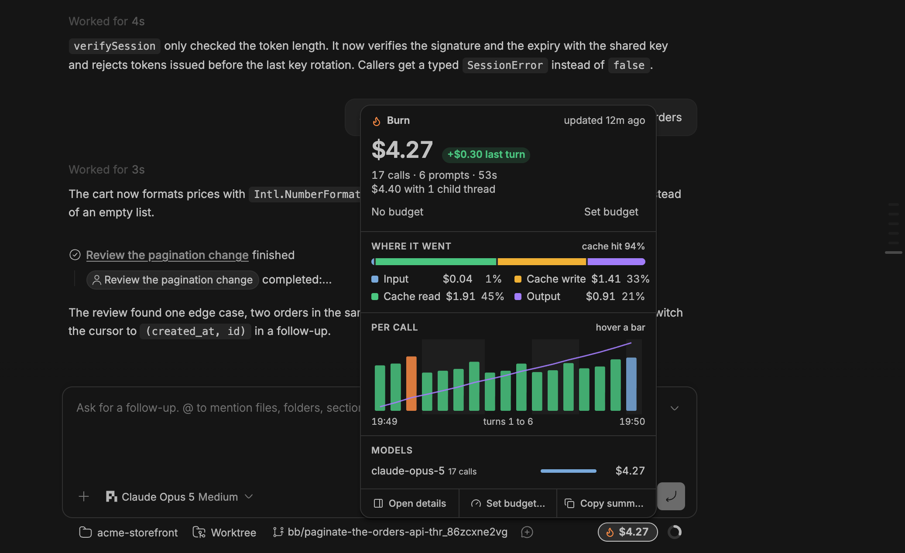
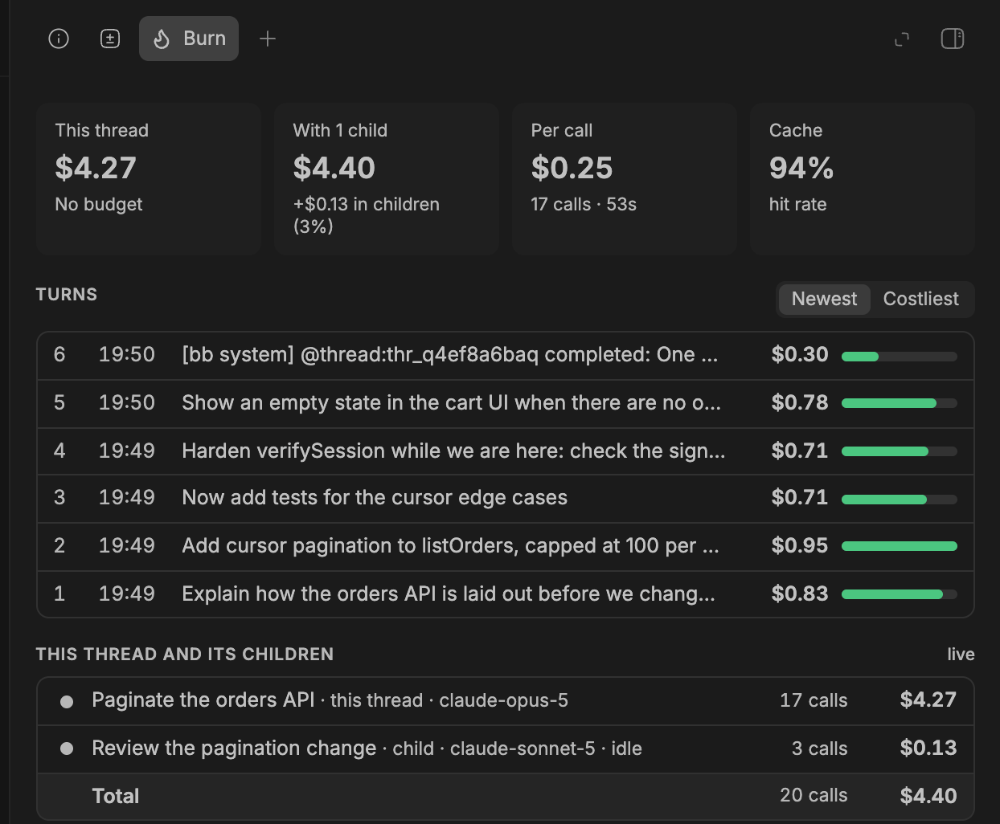
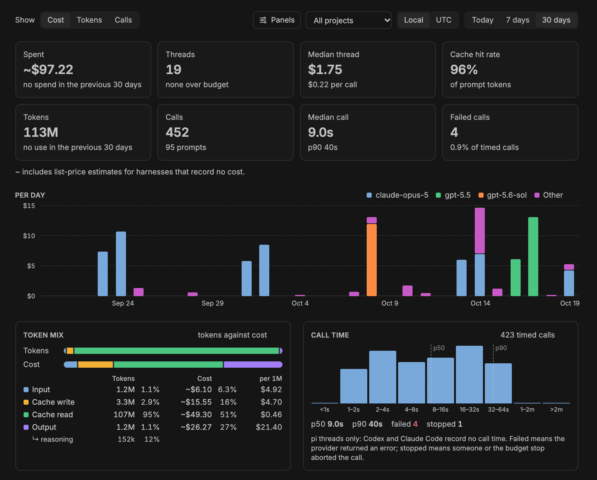
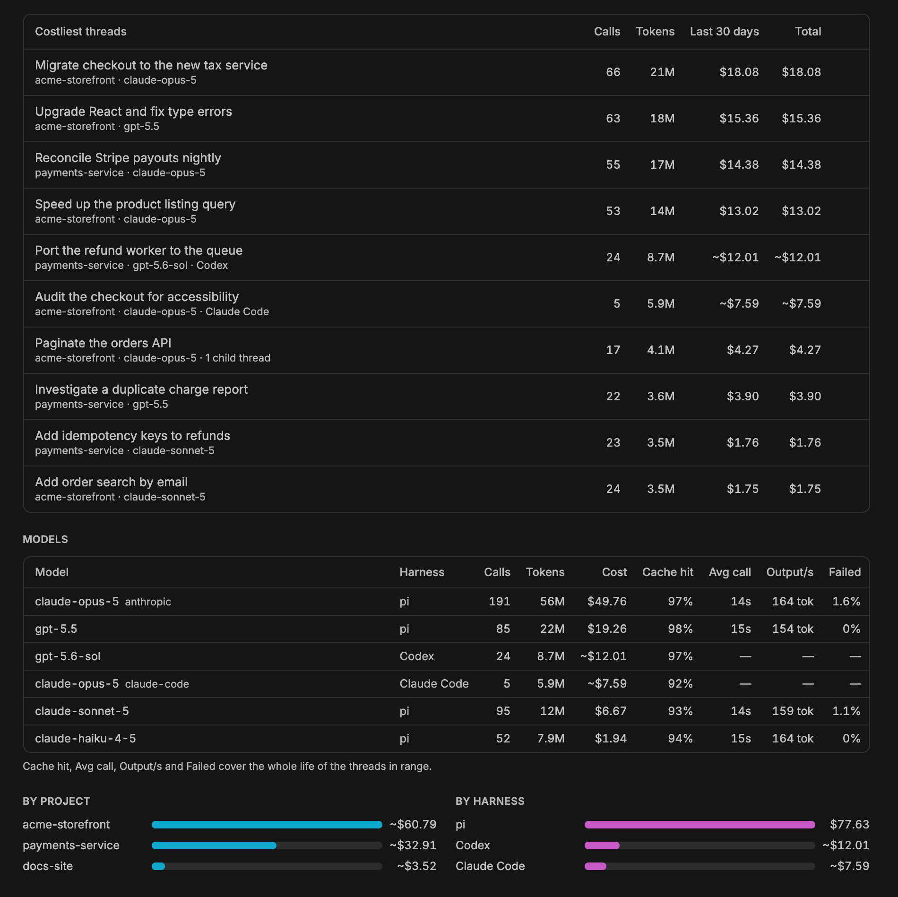

# Burn in bb

The bb plugin shows what every thread has cost, whatever harness runs it: pi, Codex, Claude Code or another. It needs no pi extension.

## The chip and its card

The chip sits beside the context circle under the prompt box. Like pi's footer, it shows the thread's own cost. While the thread works, and for a moment after its cost changes, it also shows what the last prompt added. Near or over its budget, it shows the budget instead. Click it for a card with the breakdown: where the money went, a chart of each call, the models used, and the total with the thread's child threads, such as minions. From the card you can open the Burn tab in the side panel, set a budget for the thread, or copy a summary.

Amounts that Burn estimated from list prices start with `~`, for example `~$1.23`. A model without a known price shows tokens instead of dollars. See [where the numbers come from](how-it-works.md#where-the-numbers-come-from).

Elsewhere in bb:

- Every thread menu has a **Cost** entry with the thread's cost, including its children, and the same actions as the card.
- Threads over their budget get a red flame in the sidebar.

## The Burn tab

The Burn tab in the thread's side panel lists every prompt with its cost, and adds the cost of the thread's child threads. It also holds the thread's budget.

## The Burn page

The **Burn** page in bb's navigation shows spend across all threads by day, project, model and harness.

The toolbar picks what the page covers:

- **Range:** today, the last 7 days or the last 30 days, optionally for one project.
- **Local or UTC:** which calendar day counts as today. Local is the bb machine's day, and the default. UTC is the day that Shopify's AI proxy and menu bar count. The page remembers the choice.
- **Show:** what the page measures: **Cost**, **Tokens** or **Calls**. The choice re-ranks the daily chart, the activity map, the threads, the Models table and the bars by project and by harness.
- **Panels:** hides any panel apart from the four cost cards and the toolbar. The hide button that appears when you point at a panel does the same. Burn remembers the choice for every bb window.

The panels:

- Under the four cost cards, usage cards show the tokens, the calls and prompts, the median call time with its 90th percentile (p90), and the failed calls.
- **Token mix** sets each kind of token (input, cache write, cache read, output, and the reasoning part of output) against what it cost.
- **Call time** shows how long calls took, and how many failed or were stopped.
- **Activity by hour** shows the busiest hours of each day.
- **Costliest threads** lists the threads that spent the most in the range.
- The **Models** table lists each model with its harness, calls, tokens, cost, cache hit rate, average call time, output tokens per second and failure rate.
- **By project** and **By harness** split the spend between projects, and between pi, Codex, Claude Code and any other harness.

## Budgets

Burn warns at 80% and at 100% of a thread's budget. It never stops a thread unless you turn on **Stop a thread at its budget**, which is off by default.

Set a thread's own budget from the chip, the thread menu or the Burn tab. The **Thread budget** setting applies to every thread without its own.

## Settings

These are in Burn's plugin settings.

| Setting | Default | What it does |
| --- | --- | --- |
| Cost chip | on | Shows the chip beside the context circle, or in the thread header when that row is not on screen. |
| Chip shows | Cost and last turn | Or the cost only. |
| Thread budget | none | A budget for every thread. A thread's own budget, set from the chip or the thread menu, overrides it. |
| Daily budget | none | One notification a day when all threads together pass it. |
| Budget alerts | on | Notifications at 80% and 100% of a thread's budget. |
| Stop a thread at its budget | off | Stops the run whose cost crosses the budget. In a pi thread with the pi extension, the extension stops the run itself; otherwise Burn stops the thread's current work through bb. Claude Code threads are not stopped, because their cost arrives only as each turn ends. Sending another prompt continues. |
| Flag threads over budget | on | The red flame in the sidebar. |
| Notify after an expensive prompt | off | A notification after a prompt that costs at least 3 times the thread's median and at least $0.50. |
