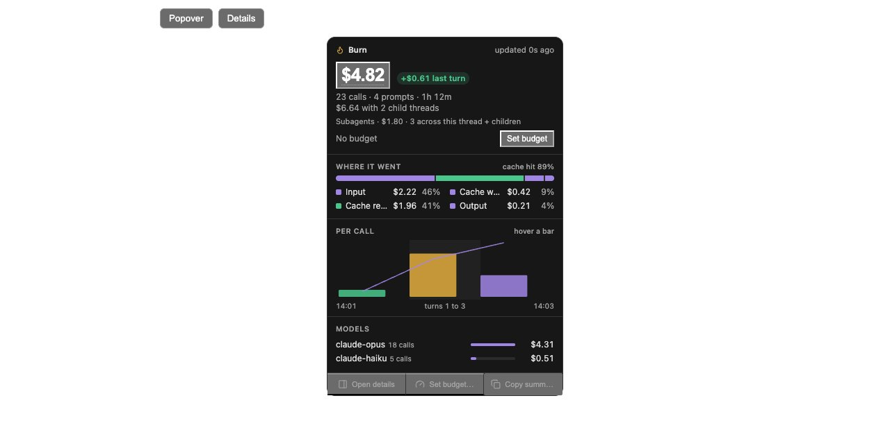
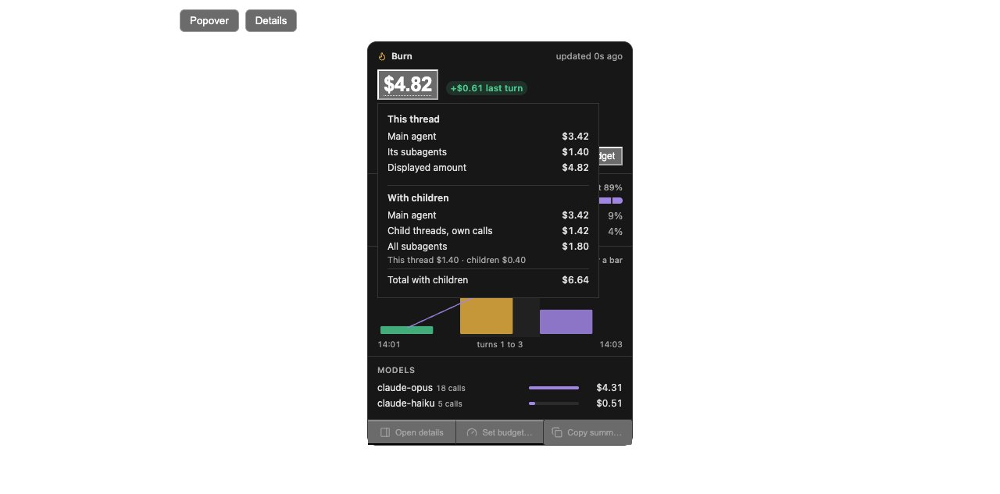
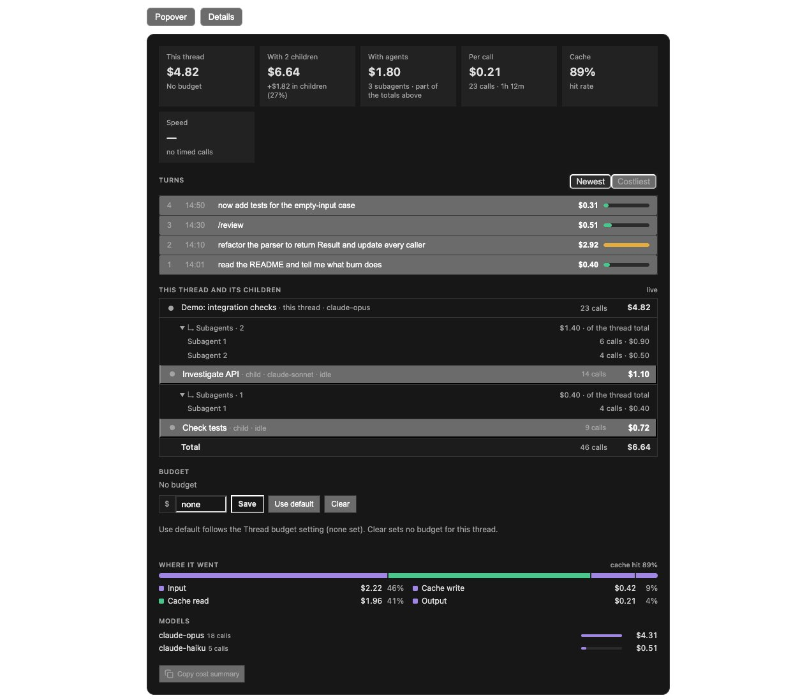
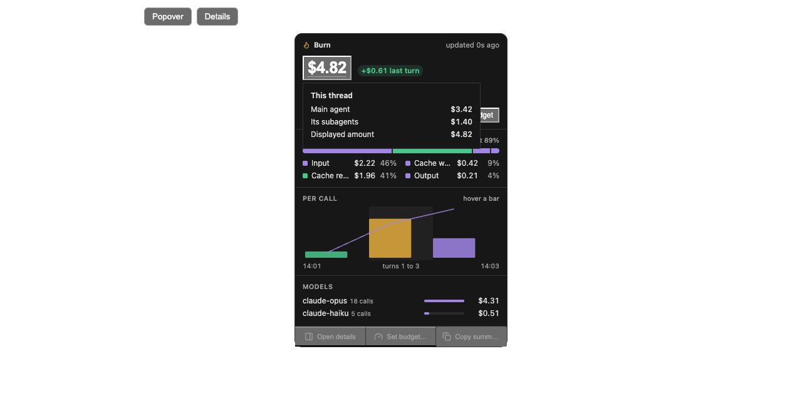

# Native agents in the existing Burn UI

Burn previously folded native-agent usage into thread totals without exposing that subset. A child BB thread can itself run native agents, so adding a new "agent cost" to its thread cost would double count. This extension keeps the existing layout and headline meanings.

## Reading the figures

- **This thread** includes the main agent and its native subagents.
- **With children** includes this thread plus each distinct BB descendant or lifecycle-owned workflow worker, once.
- **With agents** is the native-agent subset across that entire family, already included in the first two figures. It is not a third additive total.
- Nested native-agent rows belong to the immediately displayed thread. Expanding a row does not change the family total.

The demonstration has main-thread calls $3.42 + its native agents $1.40 = This thread $4.82. BB children contribute $1.82, including $0.40 from one child's native agent. The family costs $6.64; the native subset is $1.80, not an additional $1.80 charge.

## UI changes

The chip keeps its existing appearance and own-thread headline. Its popover gains one Subagents line and a calculation tooltip on the large price. The price has a muted dotted underline to make the hover target discoverable. The With children calculation section is shown only when the family contains reported BB children; native agents alone do not create that section. The tooltip opens on hover, keyboard focus or click, and closes on mouse leave, blur or Escape. Token-only reports keep their token display without a misleading dollar tooltip. The existing charts, budgets, models and actions remain.

The details page gains the third KPI after With children, plus expandable native-agent rows under both the root thread and any child with identifiable native usage. Agent numbers are neutral labels; identifiers are available in the row title.

These screenshots render the implemented React components in an isolated host harness with demonstration data. They contain no private chat content.

## Source and coverage

`UsageReport.agents` is optional and backward compatible. It carries per-agent calls, cost parts, estimation flags and coverage. It survives validation, saved reports and RPC boundaries; discounts apply to the agent's actual cost parts. Family aggregation includes every reported descendant before the existing 50-child display cap.

- Claude: saved recursive subagent files supply native identity; copied fork history and repeated message snapshots are excluded. `available` describes the available session files, not a guarantee about deleted or external history.
- Codex: distinct persisted native-child counter scopes supply identifiable agent records. Older records without those scopes cannot be reconstructed; coverage is partial.
- OpenCode: discovered child sessions supply identity. Existing depth/message caps still apply, so the breakdown is marked partial.
- Pi and other API providers: no native attribution is invented. A source without identifiable agents shows Unavailable, not zero. Direct API calls outside the recorded telemetry are not intercepted.

`≥` marks a known partial subset. Missing data never becomes an assertion that no agents were used. An incomplete tooltip shows thread/child totals instead of claiming an exact main/native split.

## Per-turn delta and refresh

The chip and popover read `family.lastTurnCost`. It includes own-thread usage plus the cost of workers whose direct ancestor was spawned in the latest parent prompt. Nested descendants follow that ancestor, so a worker finishing late stays attached to its original spawning prompt. Replaying a child's lastTurnCost on every new parent prompt is deliberately avoided. Descendant-only usage triggers parent refresh and the existing freshness animation; the chip's markup and styling are unchanged.

Limitations: creation time is the available BB causal boundary. Independent later tasks sent to an older worker cannot safely be assigned to the latest parent prompt; they remain in family totals but are excluded from that delta. Claude native background calls retain the existing timestamp grouping and may cross prompt boundaries. Thus the delta is not a billing-grade causal trace for arbitrary concurrent/reused agents. Deleted logs, old mixed Codex counters and missing native model/service-tier data remain unrecoverable.

## Validation

Unit and component tests cover native subsets, discounts, tooltip interactions, child-native rows, child-only delta refresh and preventing old worker costs from replaying in a new prompt. An isolated real-reader/server-RPC check covers root → child → lifecycle-owned grandchild, native agents at every level, duplicate usage and copied fork history. Four frozen Claude corpora retain identical totals/tokens/calls before and after this UI-attribution extension. The installed plugin was reloaded and queried through its real usage RPC. Browser screenshots exercise the actual components; they are not captures from the user's BB desktop.
